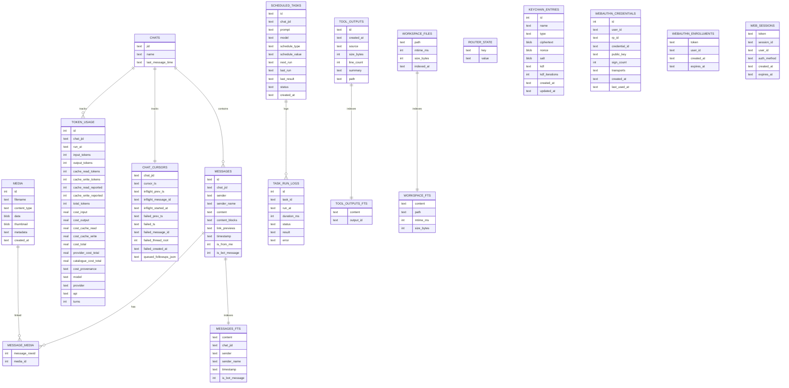

# Storage model

`piclaw` stores state in SQLite at `/workspace/.piclaw/store/messages.db`. The database is the source of truth for chat history, media, tasks, token usage, account/factor records and session ownership. Additive multi-user tables do not enable a multi-user deployment: [startup still permits only single-user mode](access-modes.md).

**Never delete this file.** Only repair or migrate it.

## Key tables

| Table | Purpose |
|-------|---------|
| `chats` | Known chat JIDs and metadata |
| `messages` | Message history |
| `messages_fts` | Full‑text search index |
| `media` | Attachment blobs |
| `message_media` | Message ↔ media join |
| `scheduled_tasks` | Task definitions |


| `task_run_logs` | Task run history |
| `token_usage` | Per‑assistant‑message token + cost usage (includes model/provider/api for per‑model tracking) |
| `budget_caps`, `budget_cap_windows` | Opt-in cap definitions, revisions and persisted calendar windows |
| `budget_work`, `budget_usage_events` | Durable work lineage and immutable idempotent usage attribution |
| `budget_allowances`, `budget_overrides`, `budget_decisions` | Bounded approvals, work-scoped warnings-only state and admission audit |
| `budget_provider_evidence` | Non-secret, account-bound provider quota observations and freshness state |
| `tool_outputs` | Stored tool-output summaries; historical scoped metadata is preserved |
| `tool_outputs_fts` | Full-text chunks keyed by output ID |
| `workspace_files` | Indexed workspace files (path, size, mtime) |
| `workspace_fts` | Full‑text index for workspace content |


| `chat_cursors` | Per‑chat cursor + inflight/failed run tracking + deferred follow‑up queue |
| `router_state` | Misc router state (auto‑compaction + web status) |
| `keychain_entries` | Encrypted secrets for tool env injection |
| `webauthn_credentials` | Independent passkeys per user/RP (credential public keys + counters); multiple keys per account and optional owner-authored label |
| `webauthn_enrollments` | Legacy single-user passkey enrolment tokens |
| `web_sessions` | Hashed bearer tokens, non-secret `session_id`, user ID, auth method, expiry and optional owner-authored login label |
| `chat_branches` | Stable branch/chat/root/parent IDs, friendly handle and explicit owner-handle namespace |
| `users` | Immutable account ID, normalised username, display name, role, enabled state and home |
| `access_state` | Activated access mode and access schema version; protects against configuration loss/downgrade |
| `session_roots` | Immutable owner and private policy for a stable root branch |
| `owned_fork_operations` | Owner/source/idempotency binding and captured JSON seed, committed with the child; `adopted_jsonl` migration seeds retain exact hash-checked child history until SDK import/persist/reopen; seed cleared only after persistence |


| `core_schema_migrations` | Core migration ledger, including removal of obsolete core remote-interop tables |

Remote Peer state belongs to the installed add-on. The obsolete core `remote_*` tables are removed by `dropObsoleteRemoteInteropSchema`; they are not a current storage API.

Attachment binaries and metadata live in `media`, with message links in `message_media`. Message records use `content_blocks` for structured file/image metadata, Adaptive Cards, and `adaptive_card_submission` receipts; `link_previews` stores preview JSON separately. Token usage rows include `model`, `provider`, and `api` for per-model tracking.

The browser keeps local UI memory that should not become shared backend state out of SQLite. That includes dismissal and seen state for the context compaction affordance. The backend decides whether the underlying context condition currently applies; the browser stores only lightweight local UI state.

## SQLite on ZFS

File-backed connections keep SQLite's FULL commit durability. ZFS connections disable mmap and use a conventional page cache. The main and native SDK writers share a checkpoint worker for each database file identity.

After the worker opens the existing file, writers disable SQLite's automatic checkpoint inside COMMIT. The worker checks WAL files of at least 4 MiB once per second and runs PASSIVE checkpoints. Readers can keep their snapshots; the worker never waits for their SQLite locks or truncates the WAL. A worker error restores the normal 1,000-page automatic checkpoint. Non-ZFS connections keep SQLite's normal checkpoint policy.

This reduces checkpoint-related HTTP stalls. Commit fsyncs and uncached reads can still wait for the filesystem on the main thread. Keep ZFS sync enabled and SQLite synchronous=FULL: disabling either weakens accepted-input durability. A WAL file can retain its allocation after a successful checkpoint, so its file size alone does not indicate uncheckpointed data.

The log operations `sqlite_checkpoint.ready` and `sqlite_checkpoint.fallback` identify worker startup and fallback. An offline database copy still requires stopping all writers; background checkpointing is not a backup.

## Access-state invariants

Schema initialisation preserves the existing default account, ownership records and native execution state. Family-specific schema initialisers are removed. Historical account, factor, migration and family tables remain untouched in deployed stores; they are not active application APIs.

Authentication maintenance removes expired web sessions and legacy pending WebAuthn enrolments. Preserve configuration, SQLite, session files and bootstrap key together. Never discard migration receipts or rewrite access markers. See [Access modes](access-modes.md).

## Entity map

The diagram below covers the older message/task core; the account/ownership/authentication tables are listed above.



## Token usage

`token_usage` stores per-assistant-message usage and cost tracking:

- `run_at` is the timestamp for the tool run (ISO 8601).
- Token counts are stored in `input_tokens`, `output_tokens`, `cache_read_tokens`, `cache_write_tokens`, and `total_tokens`.
- `cache_read_reported` and `cache_write_reported` preserve whether the provider explicitly sent each cache field. `1` includes an explicit zero, `0` means the field was omitted, and `NULL` marks a legacy or unknown state.
- `provider_cost_total` stores the provider's request charge. `catalogue_cost_total` stores Piclaw's price-catalogue calculation. `cost_total` selects the provider value when available.
- `cost_provenance` is `provider_reported`, `catalogue_estimate`, or `unavailable`. Legacy rows retain `NULL`.
- `model`, `response_model`, `provider`, and `api` identify the requested and concrete response models.

## Indexes

[Timeline and accepted-payload index setup](development/sqlite-query-indexes.md) describes schema owners, migration guards and query-plan tests. [Service-work and outbox upgrades](development/service-effect-schema-upgrades.md) covers queue membership, delivery certainty and linked-history preservation.

- `messages(timestamp)` for chronological queries
- `messages(chat_jid)` for timeline paging
- `messages(chat_jid, timestamp)` for per-chat time windows
- `messages(chat_jid, is_bot_message, timestamp)` for pollers and ingestion
- `piclaw_durable_bindings_v1(incarnation, chat_jid, source_id, payload_ref)` for SDK accepted-payload recovery
- `token_usage(chat_jid)`, `token_usage(run_at)`, and `token_usage(chat_jid, run_at)` for usage summaries
- `chats(last_message_time)` for recent chat ordering
- `scheduled_tasks(next_run)`, `scheduled_tasks(status)`, `scheduled_tasks(created_at)`, and `scheduled_tasks(last_run)` for the scheduler
- `task_run_logs(task_id, run_at)` for audit history
- `tool_outputs(created_at)` and `tool_outputs(owner_user_id, created_at)` for legacy and owner-scoped retention
- `media(created_at)` for attachment timelines
- `message_media(message_rowid)` and `message_media(media_id)` for joins
- `messages_fts`, `tool_outputs_fts`, and `workspace_fts` for full-text search
- `keychain_entries(type)` for keychain lookups
- `webauthn_credentials(user_id)` and `webauthn_credentials(rp_id)` for passkey queries
- `webauthn_enrollments(expires_at)` for enrolment cleanup
- `web_sessions(expires_at)` for session cleanup
- `users(username COLLATE NOCASE)` for account-name uniqueness
- `session_roots(owner_user_id)` for owned-root lookup
- Partial active-handle indexes for the legacy namespace and `(handle_owner_id, lower(agent_name))`
- Expiry indexes on TOTP enrolments, invitations and passkey registrations

## Imported history and archives

See [import and archive boundaries](development/legacy-import-and-archive-boundaries.md) for persisted native provenance documents and explicit JSONL archive tooling. Harness owns execution storage; the archive importer/benchmark do not supply a live AgentPool backend.

## Data paths

- `/workspace/.piclaw/store/messages.db` — SQLite database
- `/workspace/.piclaw/data/sessions/` — `pi` session JSONL history
- `/workspace/.piclaw/data/ipc/` — IPC messages and scheduled task files
- Known chat JIDs and branches live in SQLite (`chats`, `chat_branches`); do not use an old `chats.json` export as the source of truth

## Backups

`createVerifiedSqliteBackup` captures committed WAL data with `VACUUM INTO` in a private, exclusively owned staging file beside the requested destination. It verifies and syncs the snapshot, then publishes it with a hard link that fails if any destination already exists. Failure cleanup removes only staging; it never deletes or overwrites the destination. A failure after publication can leave a valid snapshot at that name, which callers can inspect with `verifySqliteBackup`.

The source must match the connection's file-backed main database. File identity is checked before and after capture and again before publication. Manifest application/schema values and migration-ledger row counts and SHA-256 fingerprints come from the verified snapshot. The recognised ledgers are `durable_schema`, `durable_metadata`, `piclaw_schema_migrations` and `core_schema_migrations`; absent tables are omitted. `sourceBytes` describes the source main file at admission and excludes WAL bytes. These fields describe the SQLite snapshot; they do not verify external payloads, credentials or a complete recovery unit. Publication requires a filesystem that supports hard links and directory sync; failures do not fall back to an overwriting copy or rename.

Back up configuration, SQLite (including all auth/access tables), session files and bootstrap key together. Use a verified SQLite backup or stop writers before copying; do not copy only an active `messages.db` while omitting WAL changes. Restore key material through a protected path, not a timeline or log. Do not remove `access_state` to make a newer store boot in an older mode/binary. See [activation and recovery constraints](access-modes.md).

Restic snapshots are stored in the configured repository. The backup script lives at:

```
/workspace/.piclaw/restic/backup.sh
```

The container image ships a pinned official `restic` binary with Azure backend support. The pinned version is tracked in the repo root at:

```
RESTIC_VERSION
```
